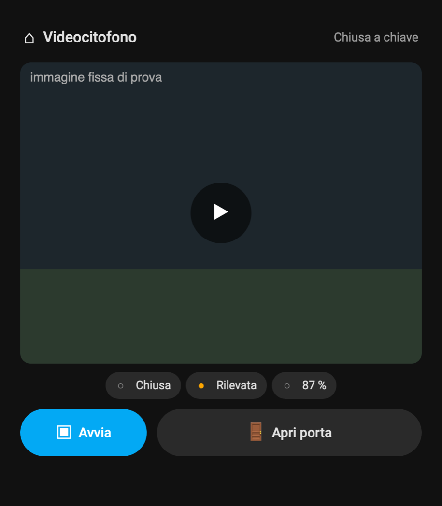
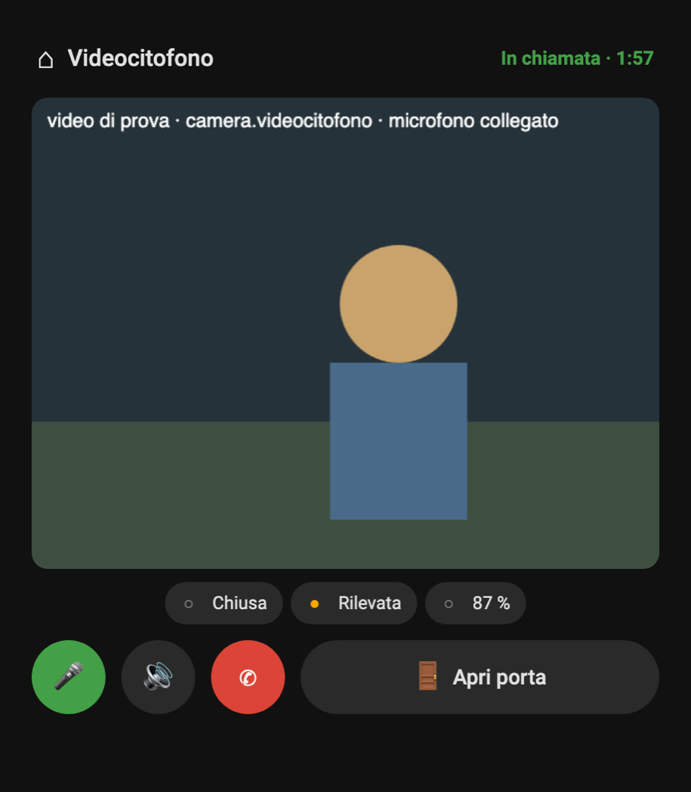

# Videocitofono card

Scheda Lovelace per il videocitofono di casa: video dal vivo e **audio bidirezionale nativo di Home Assistant**, apertura automatica quando suona il campanello e pulsante apriporta con conferma.

*Lovelace card for a video doorbell: live video and Home Assistant's native two-way audio, automatic full-screen call when the bell rings, door button with confirmation. The card and its editor are in Italian and English.*

<p>
  
  
</p>

*Immagini dalla pagina di prova, con telecamera finta e icone semplificate: in Home Assistant la scheda usa le icone e i colori del tema.*

- Nessun componente aggiuntivo: la scheda usa le API WebRTC di Home Assistant (le stesse del lettore nativo), quindi funziona con ogni telecamera che dichiara l'audio bidirezionale.
- Quando suona il campanello la chiamata parte da sola: nella scheda, oppure in una finestra a tutto schermo sopra qualunque pagina (utile sul tablet a muro).
- Pulsante apriporta con conferma in due tocchi o tenendo premuto, per evitare aperture accidentali.
- Tutte le preferenze si impostano dall'editor visuale della scheda.

## Requisiti

- **Home Assistant 2026.11 o successivo**, con la funzione **Two-way audio** accesa in *Impostazioni > Sistema > Labs*.
- Una telecamera la cui integrazione dichiara l'audio bidirezionale e trasmette in WebRTC. Al momento: Reolink (protocollo RTSP), telecamere Matter, Tapo Control dalla versione 7.3.0.
- **HTTPS** per parlare: i browser concedono il microfono solo su connessione sicura. Su `http://` la scheda mostra video e audio in ascolto, senza microfono.

## Installazione

Con HACS: *HACS > Integrazioni personalizzate (⋮) > Repository personalizzati*, aggiungi `https://github.com/hubcasale/videocitofono-card` come **Dashboard**, poi installa "Videocitofono card".

A mano: copia `dist/videocitofono-card.js` in `config/www/` e aggiungi la risorsa `/local/videocitofono-card.js` (tipo *Modulo JavaScript*) in *Impostazioni > Plance > Risorse*.

## Configurazione

Aggiungi la scheda "Videocitofono" dall'elenco delle schede e compila l'editor. In YAML:

```yaml
type: custom:videocitofono-card
camera: camera.videocitofono_trasparente
ring: binary_sensor.videocitofono_visitatore
door: lock.porta_ingresso
door_sensor: binary_sensor.porta_ingresso
auto_talk: true
popup: true
popup_people:
  - person.tablet
info:
  - binary_sensor.videocitofono_persona
  - sensor.serratura_batteria
```

| Opzione | Predefinito | Descrizione |
| --- | --- | --- |
| `camera` | | Telecamera con audio bidirezionale nativo. |
| `camera_fallback` | | Telecamera di riserva più leggera: la scheda ci passa da sola sui dispositivi che non mostrano il video della prima (per esempio un flusso ad alta risoluzione su iPhone) e se lo ricorda. |
| `ring` | | Sensore del campanello: `binary_sensor` che si accende alla suonata, oppure entità `event`. |
| `title` | Videocitofono | Titolo della scheda. |
| `door` | | Serratura o comando di apertura (`lock`, `button`, `input_button`, `script`, `switch`, `cover`, `scene`, `input_boolean`). |
| `door_action` | `auto` | Per le serrature: `open` fa scattare lo scrocco, `unlock` toglie solo la mandata, `auto` usa `open` se la serratura lo supporta. |
| `door_label` | Apri porta | Testo del pulsante. |
| `confirm` | `tap` | Conferma dell'apertura: `tap` (due tocchi) o `hold` (tieni premuto 1,5 secondi). |
| `confirm_seconds` | `5` | Tempo per il secondo tocco. |
| `door_sensor` | | Sensore porta aperta: viene mostrato e, se la porta si apre, chiude la chiamata. |
| `auto_call` | `true` | Alla suonata avvia video e audio in ascolto. |
| `auto_talk` | `false` | Alla suonata accende subito anche il microfono. |
| `popup` | `false` | Alla suonata apre la chiamata a tutto schermo sopra qualunque pagina. |
| `popup_people` | tutti | Persone per cui vale la finestra automatica (per esempio l'utente del tablet). |
| `call_seconds` | `120` | Durata massima della chiamata; `0` = nessun limite. |
| `end_on_open` | `true` | Chiude la chiamata pochi secondi dopo l'apertura della porta. |
| `talk_mode` | `open` | Microfono `open` (sempre aperto, si spegne dal pulsante) o `hold` (tieni premuto per parlare). |
| `idle` | `snapshot` | A riposo mostra un'immagine fissa (`snapshot`) o il video dal vivo senza audio (`live`). |
| `fit` | `contain` | Adattamento del video: `contain` (tutta l'immagine) o `cover` (riempi lo spazio). |
| `info` | | Sensori da mostrare sotto il video. |

## Finestra automatica

Con `popup: true` la scheda lascia sul dispositivo una copia della propria configurazione. Da quel momento, su quel dispositivo, la suonata apre la chiamata a tutto schermo in qualunque pagina delle plance di Home Assistant, anche se la scheda non è visibile. Perché funzioni il dispositivo deve aver mostrato la scheda almeno una volta, e Home Assistant deve essere aperto.

Per spegnerla su un dispositivo basta spegnere l'opzione (o togliere la persona da `popup_people`) e riaprire lì la vista con la scheda.

Se la pagina viene aperta subito dopo la suonata, per esempio da un'automazione che porta il tablet sulla vista del videocitofono, la chiamata parte comunque: vale una suonata degli ultimi 45 secondi.

## Tablet a muro

- Apri Home Assistant in HTTPS.
- Concedi al browser il permesso del microfono per il sito di Home Assistant.
- Consenti la riproduzione automatica di audio e video. Con Fully Kiosk Browser le voci sono nelle impostazioni dei contenuti web, insieme all'accesso al microfono. Senza riproduzione automatica il video parte muto e la scheda chiede un tocco per attivare l'audio.
- Lo schermo spento va riacceso da un'automazione di Home Assistant: la scheda non può farlo.

## Da sapere

- Con `auto_talk: true` chi suona sente subito quello che succede vicino al dispositivo. Usalo solo dove ha senso, limitandolo con `popup_people`.
- Alcuni videocitofoni rimandano indietro la voce di chi parla (eco). La scheda chiede al browser la cancellazione dell'eco; se non basta, `talk_mode: hold` silenzia l'audio in arrivo mentre parli.
- Gli iPhone non mostrano in WebRTC i flussi H.264 ad alta risoluzione (per esempio 2560×1920): l'audio arriva, il video resta nero. Imposta `camera_fallback` con il flusso secondario della telecamera.
- Aggiungere il microfono a un collegamento nato senza richiede di riaprirlo: il video si interrompe per un istante.

## Sviluppo

```bash
npm install
npm run typecheck
npm test
npm run build       # dist/videocitofono-card.js
npm run build:dev   # dev/bundle.js, poi: python3 -m http.server --directory dev
```

La pagina `dev/index.html` mostra la scheda fuori da Home Assistant con telecamera e microfono finti. Parametri utili: `?popup=1`, `?auto_talk=1`, `?talk_mode=hold`, `?confirm=hold`, `?mic=denied`, `?lang=en`, `?editor=1`, `?autoring=1000`.

## Licenza

MIT
